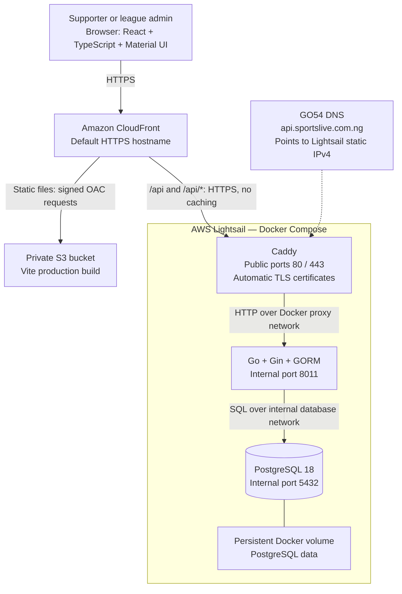
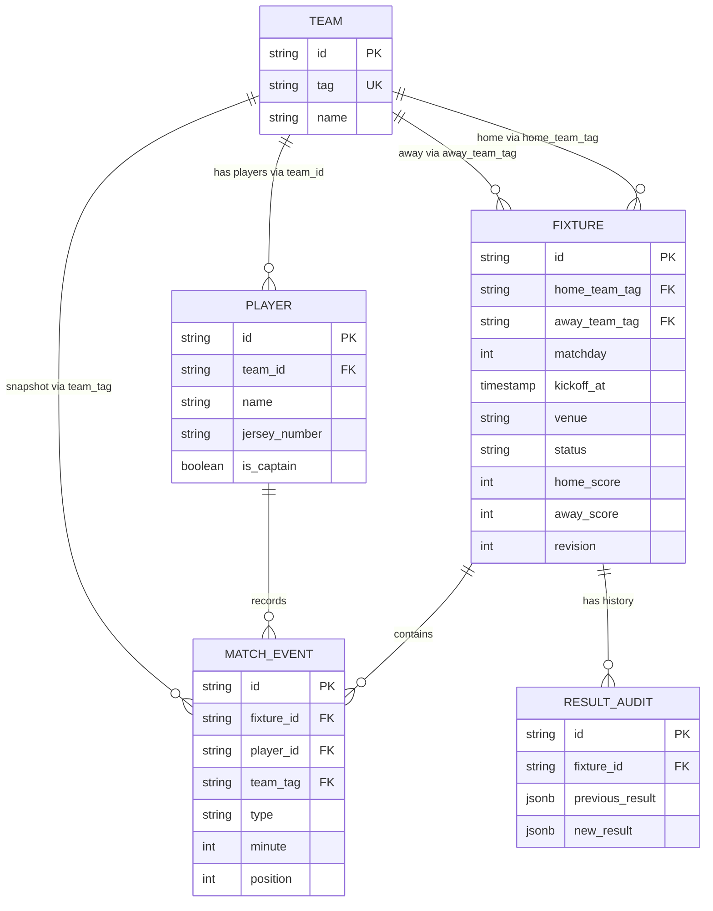

# RealEdehsons League

A football league application for managing four teams, player rosters, home-and-away fixtures, match events, results, standings, and player statistics. Public pages need no sign-in; league writes require an admin key.

## Public hostnames

- Frontend: `https://greatminds.sportslive.com.ng` (GO54 `greatminds` CNAME points to the CloudFront distribution).
- Previous frontend address: `https://edehsons.sportslive.com.ng` remains available during the domain transition.
- Keep the ACM DNS validation CNAME records in GO54 for certificate renewal.
- Backend readiness: `https://api.sportslive.com.ng/api/ready`.
- The original CloudFront URL and DuckDNS backend remain available during the domain transition.
- DNS is managed at GO54. The frontend certificate is managed by Terraform in ACM `us-east-1`; keep its DNS validation CNAME for renewal. Caddy manages the backend certificates.

## Architecture

The frontend is a static React application served from a private S3 bucket through CloudFront. The Go API and PostgreSQL run as Docker containers on one AWS Lightsail instance in London (`eu-west-2`). Caddy terminates backend HTTPS and forwards API requests to Go.



### Request flow

1. A visitor opens the CloudFront URL. CloudFront retrieves HTML, JavaScript, CSS, and the logo from S3 using Origin Access Control (OAC). Direct public access to the bucket is blocked.
2. React makes relative requests to `/api/...` on the same CloudFront hostname. Hash navigation, such as `/#fixtures`, stays in the browser and needs no server-side route fallback.
3. CloudFront routes API requests to the backend hostname `api.sportslive.com.ng` over HTTPS. API caching is disabled. Its origin request policy forwards authorization headers and uses the backend hostname instead of the viewer's Host header.
4. Caddy handles TLS, preserves the `/api` path, adds `Cache-Control: no-store`, and proxies to `backend:8011`.
5. Gin routes requests; protected handlers validate the bearer admin key. GORM reads and writes PostgreSQL.
6. Public pages and public match details refresh every 30 seconds while visible. This is polling; admins publish score updates manually. Active admin editing is not refreshed by background polling.

The browser does not connect directly to PostgreSQL. Neither PostgreSQL nor the Go port is published on the production host. The backend hostname is publicly reachable, so authorization is enforced by Go even when requests bypass CloudFront.

### Components

| Component | Responsibility |
| --- | --- |
| React, TypeScript, Material UI | Public views, admin forms, team/player dialogs, light/dark theme |
| Vite | Local development server and static production build |
| Gin | HTTP routing, admin authorization, request validation and responses |
| GORM | PostgreSQL access, transactions and schema migration |
| PostgreSQL | Teams, players, fixtures, events and result audit history |
| Caddy | Backend HTTPS and reverse proxy |
| S3 and CloudFront | Private static-file storage and public HTTPS delivery |
| Terraform | Lightsail, static IP, firewall, S3, CloudFront and state infrastructure |
| Deployment scripts | Local builds, release transfer, backend replacement, frontend upload and invalidation |

## Data model



Models also contain creation/update timestamps and a soft-delete marker. Kickoff, venue, scores, and event minute may be unconfirmed (`null`). Team tags identify teams in public routes and fixture relationships; player ownership uses the team's stable database ID.

Standings and player totals are computed from stored fixtures/events rather than manually maintained counters. Own goals count toward the opponent's score, but not the player's scoring total. Rosters display in numeric jersey order.

## Match lifecycle and consistency

Admins publish one of three result states:

| UI label | Stored status | Included in standings and player totals? |
| --- | --- | --- |
| Live | `live` | No |
| Half-time | `half_time` | No |
| Full-time | `finalized` | Yes |

Fixtures start as `scheduled`; the model also supports `postponed` and `abandoned`. Live and half-time can alternate for the second half. Finalized fixtures can be corrected only as finalized results.

Result writes use one transaction: lock the fixture, check its revision, validate roster membership and a complete goal/event list, replace events, update scores/status, increment the revision, and store the previous/new audit snapshots. Stale revisions return `409 Conflict` instead of silently overwriting another update.

Supported events are `goal`, `own_goal`, `yellow_card`, and `red_card`. A player can have at most two yellows and one red per match. The application does not infer dismissals or second-yellow exits.

Schedule generation supports up to four registered teams. It fills missing home-and-away pairings while preserving existing fixtures. The complete four-team league has 12 fixtures across six matchdays, with two games per matchday and each team playing once. Conflicting existing layouts are rejected; there is no automatic schedule-repair feature.

Kickoff edits compare calendar dates in Nigeria time (WAT, UTC+1). One matchday cannot have multiple confirmed dates, and different matchdays cannot share a date. Existing conflicting records are not automatically repaired. Live, half-time and finalized fixtures cannot be rescheduled.

## Access and networking

- Public users can read teams, rosters, fixtures, events, standings and player statistics.
- Admin writes use `Authorization: Bearer <ADMIN_TOKEN>`. There are no individual accounts or chat features.
- The frontend keeps the admin key in memory only; reload clears it. Theme preference is stored separately in browser localStorage, with light mode as the default.
- Production secrets live in the server's `.env.production`; do not put them in frontend variables, Git, or Terraform state configuration.
- Lightsail exposes HTTP/HTTPS publicly. SSH is restricted to the configured public IPv4 `/32`; update `infra/terraform.tfvars` through Terraform if the administrator's connection IP changes.
- Production uses separate Docker proxy and internal database networks. Adminer is development-only.

## Infrastructure and Terraform state

```text
infra/
  bootstrap/        Separate Terraform root: protected state bucket
  backend.tf        S3 backend declaration
  backend.hcl       State bucket, key, region and native S3 locking
  main.tf           Lightsail instance, SSH key, static IP and firewall
  frontend.tf       Private frontend bucket, OAC and CloudFront
```

The bootstrap bucket is encrypted, versioned, blocks public access, denies insecure transport, and has `prevent_destroy`. Main infrastructure state uses S3 native lockfiles and requires Terraform 1.10 or newer. Bootstrap starts with local state; keep that state securely unless explicitly migrated.

Application teardown from `infra` does not manage the separate bootstrap root. The frontend bucket is disposable (`force_destroy = true`); the state bucket is not. **Destroying Lightsail deletes the PostgreSQL data on its attached disk. A Docker volume is not an off-server backup.**

Swap and Docker were installed manually on Lightsail; that host setup is not yet automated in Terraform.

## Development and deployment

Source layout:

```text
backend/
  main.go           Application startup
  database/         Connection setup and startup migrations
  models/           GORM models and response DTOs
  router/           Gin routes, handlers, validation and calculations
frontend/
  src/              React application, components, API client and theme
  public/           Static league logo
compose.yml         Local PostgreSQL, backend, Adminer and Compose Watch
compose.production.yml  Production PostgreSQL, backend and Caddy
caddyfile           Backend proxy configuration (mounted as Caddyfile in production)
deploy_backend.sh   Backend release and backup workflow
deploy_frontend.sh  Static frontend release workflow
```

Local frontend requests are proxied by Vite to `127.0.0.1:8011`; production requests use CloudFront. See [frontend/README.md](frontend/README.md) for frontend commands and API details.

Run verification from the project root:

```bash
go -C backend test ./...
npm --prefix frontend test
npm --prefix frontend run build
```

Deploy from your Mac, with Docker, Go, AWS CLI, Terraform credentials, and SSH access configured:

```bash
bash deploy_backend.sh
bash -e deploy_frontend.sh
```

Deploy the backend first when the frontend depends on a new API contract. The backend script builds `linux/amd64` locally, uploads to Lightsail, creates a PostgreSQL custom-format dump, retains the previous image, replaces only the API container, and checks public readiness. It attempts an application-image rollback on failure; database migrations are not automatically reversed.

A successful backend deployment copies its pre-deployment database dump to the Mac's `backups/` directory. Archive listing is checked, but a full restore test, scheduled off-server backups, and release/backup retention are not yet implemented. If copying the dump back fails, the deployment may already have succeeded and the server copy remains.

The frontend script builds Vite assets, uploads assets before `index.html`, then invalidates `/`, `/index.html`, and `/crest.svg` in CloudFront. It does not deploy the backend or modify Terraform infrastructure.

## Current limits

- One league/season; no season-management UI.
- One small Lightsail host: API and database share memory and a failure domain.
- Shared admin key rather than individual admin accounts.
- Polling rather than WebSockets; no automatic match clock or external score feed.
- Startup migrations run with the backend; readiness must succeed after deployment.
- No automatic repair of existing schedule/date conflicts.
- No automated backup schedule, tested restore procedure, or automatic retention yet.

### Viewer PIN access

The public app (Roaster and League) requires one shared six-character alphanumeric viewer PIN (ASCII letters and numbers, at least one of each, case-sensitive). The initial PIN for new installations is `GM4492`, seeded only when viewer access settings do not exist. Admin changes it under **Dashboard → Viewer access**; changing the PIN invalidates all viewer sessions. The administrator key remains separate. Existing PIN hashes are never reset by this format change: admin must set a compliant six-character code before new viewer logins can succeed. Existing sessions retain their expiry rules until admin rotates the code, which signs all viewers out.

Viewer sessions use a random HttpOnly cookie and a hashed server-side token. They expire after **2 hours without user activity**, with a maximum lifetime of 24 hours. Background data polling and page reloads do not reset inactivity. Trusted pointer, keyboard, touch and scroll events send throttled activity renewals; open tabs share activity notifications. The server rejects idle, expired, revoked and logged-out sessions. The cookie is Secure on hosted domains; localhost supports local development.

All data API routes require a viewer session or a valid admin bearer key. `/api/health` and `/api/ready` stay available for monitoring. Login attempts are limited on the server. No PIN or session credential is stored in localStorage.

### Annual membership dues

An annual dues setting fixes the monthly amount for one calendar year. The
2026 rate is ₦1,000. Active members receive charges through December, starting
from January of their membership year and never before January 2026. Unpaid months before the first active paid dues period are automatically waived with audit history. With no active monthly payment, dues are owed from January. Receipt dates do not determine the starting month. Reversing payments recalculates only automatic waivers; manual waivers and financial history are preserved. Existing paid, waived,
and unpaid charges keep their original amounts and history.

Admin uses **Adjust fees → Monthly dues** to configure a future year's monthly
rate. Once any charges exist for a year, its rate is locked. Future years are
issued on the first register access or membership command after January 1;
issuance is idempotent. Without a configured rate, that year's new charges are
not issued and admin sees a warning. Configure next year's rate before January.
Inactive members retain existing records but receive no new charges.

Admin can record full payment for any issued month, including future months in
the current year. Receipt dates cannot be in the future. Outstanding annual
balances include future issued months and should not be interpreted as overdue.
